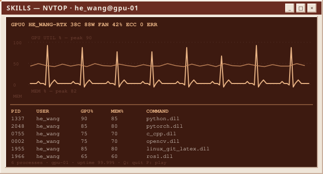

<!-- GitHub profile README — retro GUI / win95 / tape-futurism aesthetic -->
<!-- assets are hand-drawn SVGs; light theme = paper-tape beige, dark theme = ZUTOMAYO midnight -->

<p align="center">
  <picture>
    <source media="(prefers-color-scheme: dark)" srcset="assets/banner-dark.svg">
    
  </picture>
</p>

<p align="center">
  <a href="https://he-seri-wang.github.io"><b>🌐 he-seri-wang.github.io</b></a>
  ·
  <a href="https://he-seri-wang.github.io/blog.html">📝 blog</a>
  ·
  <a href="mailto:he.wang.25@ucl.ac.uk">✉ he.wang.25@ucl.ac.uk</a>
</p>

---

<p align="center">Everything else lives on the site — here, just the tape deck. Press PLAY:</p>

<p align="center">
  <details>
    <summary><picture><source media="(prefers-color-scheme: dark)" srcset="assets/btn-play-dark.svg"></picture></summary>
    <picture><source media="(prefers-color-scheme: dark)" srcset="assets/deck-playing-dark.svg"></picture>
  </details>
  <details>
    <summary><picture><source media="(prefers-color-scheme: dark)" srcset="assets/btn-stop-dark.svg"></picture></summary>
    <picture><source media="(prefers-color-scheme: dark)" srcset="assets/deck-stopped-dark.svg"></picture>
  </details>
  <details>
    <summary><picture><source media="(prefers-color-scheme: dark)" srcset="assets/btn-eject-dark.svg"></picture></summary>
    <picture><source media="(prefers-color-scheme: dark)" srcset="assets/deck-eject-dark.svg"></picture>
  </details>
</p>

<p align="center">
  <picture>
    <source media="(prefers-color-scheme: dark)" srcset="assets/label-skills-dark.svg">
    
  </picture>
</p>

<p align="center">
  <picture>
    <source media="(prefers-color-scheme: dark)" srcset="assets/skills-dark.svg">
    
  </picture>
</p>

<details>
<summary><code>type about_me.txt</code></summary>

```
- 🎧 trains neural nets on j-pop (ずっと真夜中でいいのに。/ ZUTOMAYO · ヨルシカ)
- 🤖 once taught a bipedal robot arm to move; the robots remember
- 📼 believes dithering, CRT scanlines and tape hiss are design features
- 🌏 route: Guangzhou → Hangzhou → Muroran → London
```

</details>

---

<p align="center">
  <a href="https://he-seri-wang.github.io">[ 🌐 site ]</a>
  <a href="https://he-seri-wang.github.io/blog.html">[ 📝 blog ]</a>
  <a href="mailto:he.wang.25@ucl.ac.uk">[ ✉ mail ]</a>
  <a href="https://www.linkedin.com/in/he-wang-414628321/">[ 💼 linkedin ]</a>
  <a href="https://orcid.org/0009-0001-7774-8880">[ 🗂 orcid ]</a>
  <a href="https://github.com/He-seri-Wang">[ 💾 github ]</a>
</p>
